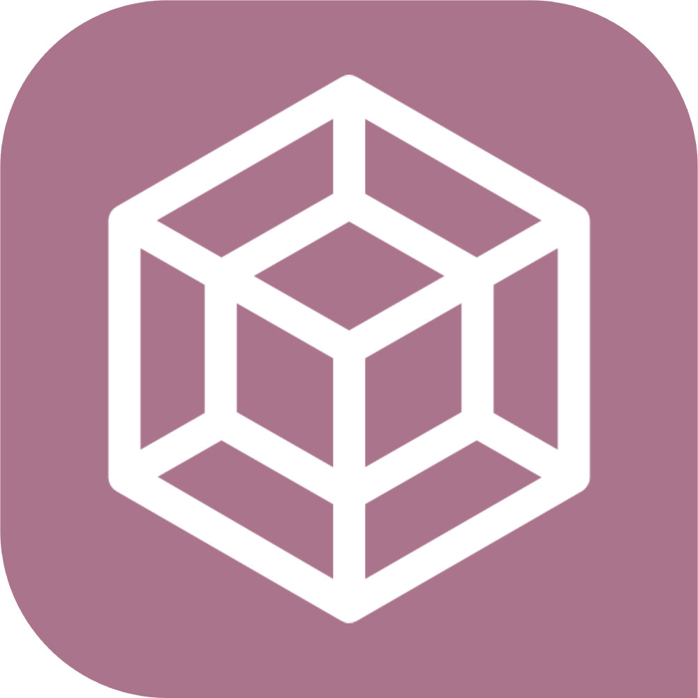
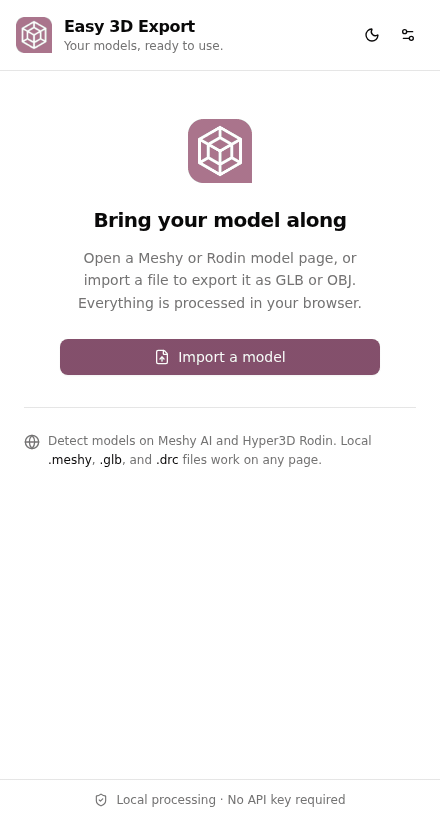

<p align="center">
  
</p>

<h1 align="center">Easy 3D Export</h1>

<p align="center">
  Your 3D models, ready to use.<br />
  Download from <strong>Meshy AI</strong> and <strong>Hyper3D Rodin</strong>, or convert local files to <strong>GLB</strong> and <strong>OBJ</strong>.
</p>

<p align="center">
  
  
  <a href="LICENSE"></a>
</p>

<p align="center">
  <a href="#quick-start">Install</a> ·
  <a href="#quick-demo">Demo</a> ·
  <a href="#supported-models">Supported models</a> ·
  <a href="docs/ADD_A_PROVIDER.md">Build a plugin</a>
</p>

## Quick demo

<p align="center">
  
</p>

*Recorded from the built extension using a generated cube and a mocked provider response. No personal model or live signed URL is included.*

## What you can do

- **Download your models** from Meshy AI and Hyper3D Rodin in Chrome’s side panel.
- **Export GLB or OBJ** without an extension account, API key, or conversion server.
- **Keep available textures** in GLB exports, or save OBJ, MTL, and textures together as a ZIP.
- **Choose the right variant**: Meshy generation and texture tasks are grouped, with successful textured variants preferred.
- **Import your own files**: drop a `.meshy`, `.drc`, or `.glb`, paste a model URL, or import provider JSON.
- **Preview before exporting** with orbit controls, wireframe, and reset view.
- **Control each integration** with saved switches in **Settings → Provider plugins**. Meshy and Rodin are both enabled by default.

## Supported models

| Source | Input | Available outputs |
| --- | --- | --- |
| Meshy AI | Detected models or `.meshy` v1 files | Original, GLB, OBJ ZIP |
| Hyper3D Rodin | Detected preview geometry or standalone `.drc` triangle meshes | Original DRC, uncompressed GLB, OBJ ZIP |
| Local files | `.glb`, `.meshy` v1, `.drc` | Original, GLB, OBJ ZIP |

**Rodin preview geometry:** a DRC file contains only the attributes supplied by the provider. Materials, textures, and a scene hierarchy cannot be reconstructed when they are absent. Preview images are not treated as texture maps.

## Quick start

Requires **Chrome**, **Node.js 22.12+**, and **pnpm**. Installation currently uses Chrome’s developer mode.

```bash
git clone https://github.com/ayoub-sahraoui/easy-3d-export.git
cd easy-3d-export
pnpm install --frozen-lockfile
pnpm build
```

1. Open `chrome://extensions` and enable **Developer mode**.
2. Choose **Load unpacked** and select the project’s `.output/chrome-mv3` folder.
3. Pin **Easy 3D Export**, then click its icon to open the side panel.
4. Open a Meshy or Rodin model page. Refresh the page if it was already open when you installed the extension.

### Export a model

1. Open one of your models on a supported provider page.
2. Wait for the model and its available variants to appear in the panel.
3. Choose **GLB**, **OBJ**, or **Original**, then start the export.

You can also choose **Import a model** to use a local file, a public model-page URL, a direct HTTPS asset link, or provider JSON. Local file conversion works on any page, even with both provider plugins disabled.

### Manage provider plugins

Open **Settings → Provider plugins** to switch Meshy AI or Hyper3D Rodin on or off independently. Changes are saved and apply across tabs immediately.

Disabling a plugin stops its page scanning, network observation, and new page/JSON imports. Its automatically detected models are hidden until it is enabled again. Existing manual imports remain available. If a model loaded while its plugin was disabled, refresh its page after enabling it.

## Local processing and permissions

Conversion runs in your browser using a dedicated worker and bundled decoders. There are no conversion uploads, analytics, or remotely loaded scripts. Model files stay in memory until you save them; only preferences are persisted.

The extension observes model metadata on supported provider pages and downloads the assets they expose. Additional asset hosts may require explicit per-site permission. Turning off a provider plugin stops its behavior; it does not revoke Chrome’s installed host permissions.

See [architecture and permissions](docs/ARCHITECTURE.md) for the implementation details.

## Development

Built with **WXT, React, TypeScript, Tailwind CSS, shadcn/ui, and Three.js**.

```bash
pnpm dev          # development build with hot reload
pnpm test         # unit and integration tests
pnpm typecheck    # TypeScript checks
pnpm build        # production Chrome extension
pnpm zip          # package the extension as a ZIP
```

The test suite covers provider parsing, plugin settings and lifecycles, tab synchronization, local binary transfer, and synthetic Meshy/Draco conversion through GLB and OBJ export. Tests run with local fixtures and do not contact provider APIs.

```text
src/
├── plugins/       # Meshy, Rodin, registry, contract, saved preferences
├── entrypoints/   # background, shared content scripts, side panel
├── conversion/    # format-based decoders, exporters, conversion worker
├── features/      # detection, imports, conversion actions
├── components/    # panel UI and shadcn primitives
├── core/          # models, messaging, validation, tab state
├── downloads/     # asset fetching, permissions, save and ZIP handling
└── tests/         # sanitized provider fixtures and conversion tests
```

### Add another provider

Implement the [provider plugin contract](src/plugins/types.ts), then register the plugin in [the registry](src/plugins/registry.ts). The settings rows, content-script match patterns, manifest host permissions, and provider import routing are derived from that registration.

Follow the [provider plugin guide](docs/ADD_A_PROVIDER.md) for endpoint rules, normalization, fixtures, and testing. File conversion stays independent of provider plugins.

## Troubleshooting

| Problem | What to try |
| --- | --- |
| A model does not appear | Check that its plugin is enabled, then refresh the provider page. Detection cannot recover a network response it never observed. |
| A signed asset URL has expired | Refresh the provider page to obtain a fresh link. |
| A download needs site access | Use **Grant access and retry** for that asset host. |
| A private Rodin URL cannot be imported | Open the model in your logged-in Rodin workspace and let the extension observe its task response. |
| An update does not show | Reload the extension in `chrome://extensions`, then refresh its provider tabs. |

## Current limits

- Meshy decoding supports **container version 1**.
- Standalone Draco **triangle meshes** are supported; point clouds are not.
- Draco-compressed GLB (`KHR_draco_mesh_compression`) and KTX2 textures are not decoded.
- OBJ cannot preserve every PBR or animation feature. Skinned meshes export in bind pose; non-triangle primitives are skipped with a warning.
- Texture attachment requires existing UVs and an unambiguous material assignment.
- Additional providers and export formats require an implemented, tested plugin or codec.

## License and credits

[MIT](LICENSE). Decoder research and third-party notices are listed in [THIRD_PARTY.md](docs/THIRD_PARTY.md), including [meshy2glb](https://github.com/Amal-David/meshy2glb), [meshoptimizer](https://github.com/zeux/meshoptimizer), and [Google Draco](https://github.com/google/draco).

Easy 3D Export is not affiliated with Meshy AI or Hyper3D. Export only models you own or have permission to use.
